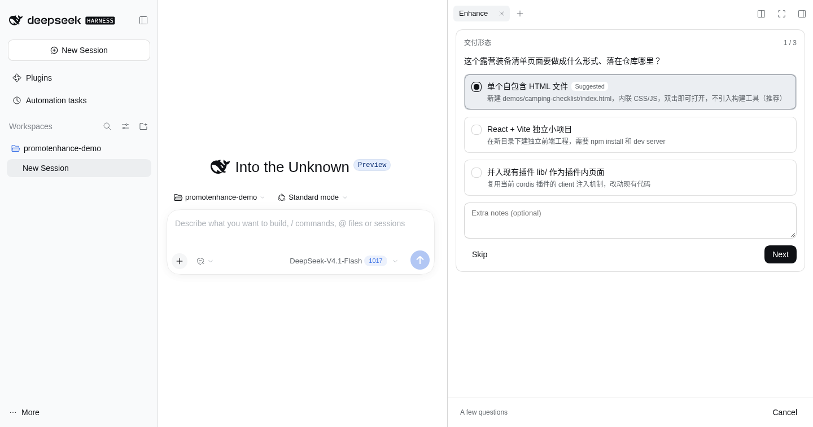
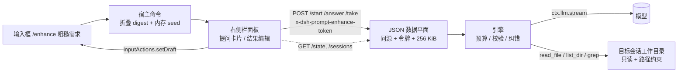
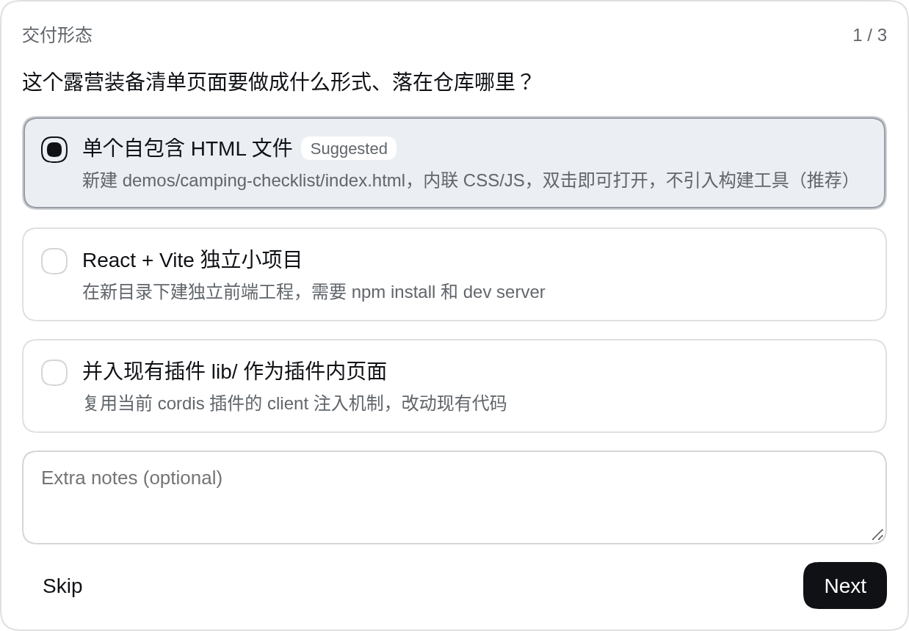
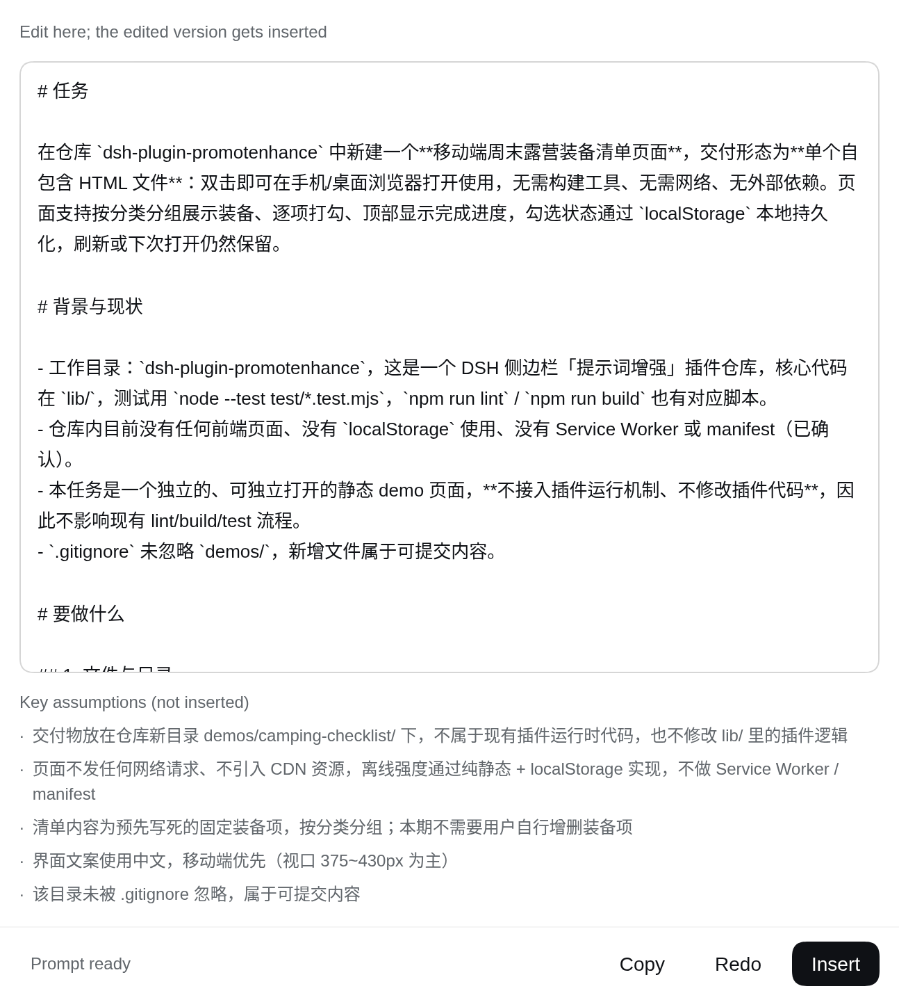
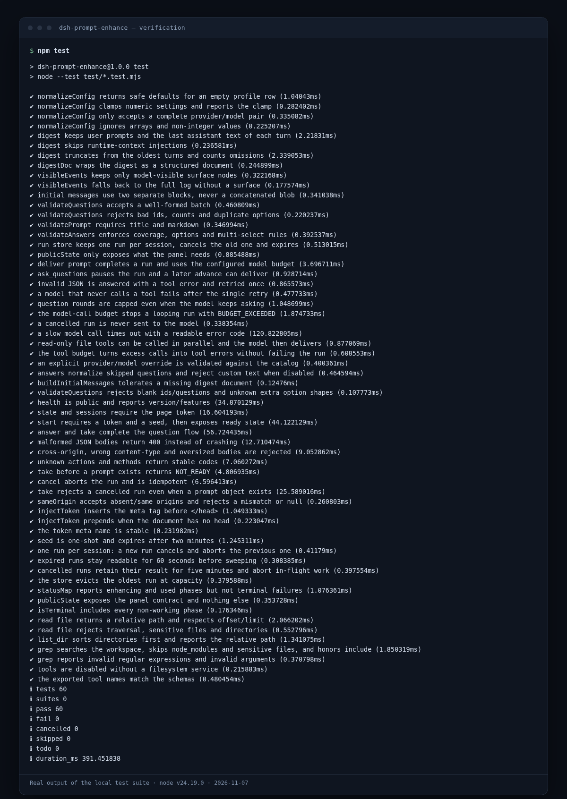

<p align="center">
  
</p>

<h1 align="center">提示词增强 · dsh-prompt-enhance</h1>

<p align="center">
  在 DSH 输入框里敲 <code>/enhance 一句粗糙需求</code>，右侧面板问几个关键问题，<br>
  然后把一份可以直接执行的完整提示词写回输入框 —— <strong>全程不创建任何 DSH 会话</strong>。
</p>

<p align="center">
  <a href="https://github.com/EstimateFaster/dsh-plugin-promotenhance/actions/workflows/ci.yml"></a>
  <a href="https://github.com/EstimateFaster/dsh-plugin-promotenhance/releases/tag/v1.0.0"></a>
  <a href="LICENSE"></a>
  <a href="package.json">= 20"></a>
</p>



## 为什么值得装

大多数“提示词增强”只是把一句话改写得更好看。真实开发里缺的往往是**只有用户知道的信息**：
目标形态、验收标准、能不能引入依赖、代码放哪。这个插件把这些信息问清楚，
再结合目标会话的上下文（以及当前工作目录里的真实文件）产出一份可执行的提示词。

**它不开新会话。** 增强过程只活在插件内存和右侧面板里，不会出现在左侧会话列表，
不会写进会话记录，也不会弄脏 `$DSH_HOME/sessions`。

## 特性

- **零会话污染**：`/enhance` 只留下内存里的启动材料；问题和答案走独立 JSON 路由，不进入聊天转写。
- **结构化澄清**：模型只能通过 `ask_questions` / `deliver_prompt` 两个工具回复，1–3 题、推荐项置顶、可跳过、可自定义。
- **读真实代码再写提示词**：`read_file`、`list_dir`、`grep` 只读工具让模型先看清现有脚本、测试框架和目录约定。
- **一键写回**：结果可编辑、可复制、可重新生成；点“插入”直接写入当前会话的输入框。
- **预算可控**：每轮模型调用、提问轮数、工具次数、超时和 token 都有上限，不会无限烧额度。
- **失败可读**：稳定的错误码 + 中英文案；超时、预算、路径、令牌失败都有明确提示。
- **默认安全**：页面令牌 + 同源校验 + JSON 限制 + 256 KiB 正文上限；文件工具锁死在当前工作目录，拒绝密钥/环境文件。
- **零第三方依赖**：只用 Node.js 标准库，不引入 schema、HTTP 或日志框架。

## 快速开始

### 前置条件

- 一个可运行的 DSH Web profile（`dsh web`），Node.js **>= 20**。
- 已配置可用的模型 provider（面板会使用 DSH 的默认模型，或在配置里覆盖）。

### 安装到 profile

```sh
git clone https://github.com/EstimateFaster/dsh-plugin-promotenhance.git
cd dsh-plugin-promotenhance

# 1) 把本地目录链接进 web profile（dsh 会转发给 pnpm）
dsh plugin --profile web add link:$PWD

# 2) 确保 profile 的 package.json 把它列进 bundles
#    编辑 $DSH_HOME/profiles/web/package.json，在 dsh.profile.bundles 中加入：
#    "dsh-prompt-enhance"

# 3) 重启 Web 宿主
dsh web
```

> 也可以在 DSH 的「Plugins」页面安装/启用；宿主侧插件和客户端 bundle 都是**启动时加载**，
> 装完后需要重启一次 `dsh web`。

验证宿主已加载（无需令牌）：

```sh
curl -s http://127.0.0.1:3081/prompt-enhance/health
# {"ok":true,"name":"dsh-prompt-enhance","version":"1.0.0","uptimeMs":...,"fileTools":true}
```

### 最小可运行示例

1. 打开任意会话，在输入框输入并发送：

   ```text
   /enhance 做一个本地记账小工具，用 JSON 文件存数据，要有命令行和测试
   ```

2. 右侧栏出现「Enhance / 提示词增强」面板。若信息不足，会给出 1–3 道选择题；
   推荐项已预选，可点 **Next / Submit**，也可以 **Skip** 或补充文字。
3. 生成完成后，面板里是可编辑的完整提示词。点 **Insert** 写回当前输入框，
   再按正常流程发送即可。点 **Copy** 可复制，点 **Redo** 可基于同一份上下文重新生成。

只发 `/enhance`（不带内容）也可以：面板会先问你要做什么。
面板被关掉后，从右侧栏「开始」页的「提示词增强」卡片可以重新打开。

## 配置

在 profile 的 `cordis.patch.yml` 里按 `prompt-enhance` 这个 id 覆盖配置：

```yaml
- id: prompt-enhance
  config:
    provider: deepseek
    model: deepseek-flash
    reasoningEffort: high
    timeoutMs: 120000
    maxTokens: 6000
    maxQuestionRounds: 2
    maxModelCalls: 10
    maxToolCalls: 12
    maxRoughChars: 8192
    fileTools: true
```

| 配置项 | 类型 | 默认值 | 说明 |
| --- | --- | --- | --- |
| `provider` | string | 空 | 与 `model` 同时设置才生效；否则使用会话默认模型 |
| `model` | string | 空 | 同上；会先在 provider 的模型目录中校验 |
| `reasoningEffort` | string | 空 | 透传给模型调用（如 `high`），不填则用默认值 |
| `timeoutMs` | integer | `120000` | 单次模型调用超时；范围 5 000–600 000 |
| `maxTokens` | integer | `6000` | 单次输出 token 预算；范围 512–32 000 |
| `maxQuestionRounds` | integer | `2` | 最多几批提问；`0` 表示禁用提问，强制直接交付 |
| `maxModelCalls` | integer | `10` | 每个 run 的模型调用总上限；范围 2–30 |
| `maxToolCalls` | integer | `12` | 每个 run 的只读工具调用上限；范围 0–50 |
| `maxRoughChars` | integer | `8192` | `/enhance` 接受的粗糙提示词字符上限；范围 256–65 536 |
| `fileTools` | boolean | `true` | 是否向模型暴露 `read_file` / `list_dir` / `grep` |

未通过校验的数字会被夹到安全范围并写一条 warn 日志；只设置 `provider` 或只设置
`model` 时会回退到默认模型，不会让插件加载失败。

## 它是怎么工作的



一次完整流程：

```text
/enhance <rough>
  ├─ 宿主：把当前会话折成 digest（用户消息 + 每轮助手收尾），存内存 seed，不调模型
  ├─ 客户端：监听命令成功 → 打开右侧面板
  ├─ POST /start → 模型决定 ask_questions 或 deliver_prompt
  ├─ 用户作答 → POST /answer → 答案作为 tool result 回灌
  ├─ deliver_prompt → 校验 → 面板可编辑结果
  └─ 点 Insert → inputActions.setDraft() → POST /take → phase=inserted
```

### 数据与协议

- **模型侧**：第一条 user 消息是两个独立 block（粗糙提示词 + `session-digest` JSON）；
  答案以 `role: "tool"` 的结果回灌，不拼成自然语言。
- **浏览器 ↔ 宿主**：`/prompt-enhance/start|answer|cancel|take` 为 POST，
  `/state|sessions|health` 为 GET；统一 JSON 外壳。
- **状态权威**：宿主内存。面板刷新、换标签页都不改变事实；宿主重启后显示“已失效”，
  重新 `/enhance` 即可。

| 端点 | 方法 | 用途 |
| --- | --- | --- |
| `/prompt-enhance/health` | GET | 版本、uptime、文件工具可用性（无令牌） |
| `/prompt-enhance/state?session=…` | GET | 当前 run 状态（需页面令牌） |
| `/prompt-enhance/sessions` | GET | 侧栏角标状态（需页面令牌） |
| `/prompt-enhance/start` | POST | 消费 seed，启动/复用 run |
| `/prompt-enhance/answer` | POST | 提交一批答案 |
| `/prompt-enhance/cancel` | POST | 取消当前 run |
| `/prompt-enhance/take` | POST | 标记已插入，可带回编辑后的 markdown |

## 更多截图

| 提问卡片 | 结果面板 |
| --- | --- |
|  |  |

## 安全与隐私

- 路由只挂在现有 DSH Web 服务上，与页面同源同端口；不额外监听端口。
- 每次宿主启动生成随机页面令牌，经 SPA index 的
  `<meta name="dsh-prompt-enhance-token">` 下发；所有状态请求都要带
  `x-dsh-prompt-enhance-token`。这挡住了本地进程盲调与 DNS rebinding 的大部分路径。
- POST 还要求 `Origin` 与 `Host` 一致、`Content-Type: application/json`，正文上限 256 KiB。
- 文件工具用 `ctx.fs.resolve` + `contains` 做规范路径包含校验；拒绝 `../` 逃逸、符号链接逃逸、
  `.env`、`.credentials.yaml`、`*.pem`、`*.key` 等敏感文件。
- 模型可见的 digest 只带工作区**名字**，不带宿主机绝对路径；生成的提示词不会把
  宿主绝对路径带进浏览器。
- 插件自身不写文件、不执行命令、不持久化增强历史。

## 本地开发

```sh
npm test          # 60 个 node:test 单元/集成测试
npm run lint      # 语法、版本、敏感路径/密钥、占位符、截图预算
npm run build     # 包元数据 + 客户端 bundle 注册检查
npm run check     # lint + build + test
```

无第三方依赖，无需 `npm install` 即可运行测试。CI 在 Node 20 / 22 / 24 上跑同一套命令。

真实界面截图来自隔离的 DSH Web 实例（端口 3099、独立 `DSH_HOME`、真实模型调用），
不是合成图；复现脚本见 [`scripts/screenshot.mjs`](scripts/screenshot.mjs)。



## 已知限制

- **状态只在内存**：宿主重启后 run 失效，面板会提示重新 `/enhance`；不做历史持久化（有意为之）。
- **单会话单任务**：同一会话再次 `/enhance` 会取消旧 run；最多同时保留 8 个 run。
- **文件工具只读**：只能看当前会话工作目录，不能写文件、跑命令或访问目录外路径。
- **不做流式渲染**：面板用 700 ms 轮询显示阶段状态；没有 SSE。
- **摘要只截断不压缩**：保留最近 16 轮 / 24 000 字符，超出时从最旧轮次丢弃，并把
  `truncated` / `omittedTurns` 告诉模型。
- **超长结果**：`maxTokens` 可调，但超过模型输出上限的提示词仍可能被截断；
  面板允许编辑，建议必要时拆分为多个任务。
- **grep 的 ReDoS 面**：模型生成的 200 字符以内正则会在最多 2 MiB 文本上执行；
  这是本机单用户工具的已知取舍，不建议在多租户环境暴露。
- **浏览器 UI 的自动化覆盖**：客户端 bundle 由 VM 注册检查 + 真实 E2E 截图覆盖，
  没有引入 DOM 测试依赖。

## FAQ

**面板没出现？**
确认 `dsh web` 已重启，且 profile 的 `dsh.profile.bundles` 包含 `dsh-prompt-enhance`；
打开浏览器开发者工具看 `/prompt-enhance/state` 是否返回 200。

**提示“页面令牌失效”？**
宿主重启后旧页面里的令牌会失效，刷新一次页面即可。

**提示“没有可用的默认模型”？**
先在 DSH 里配置 provider/API key，或在 `cordis.patch.yml` 里显式设置 `provider` + `model`。

**为什么结果里没有绝对路径？**
这是有意的：模型只拿到工作区名字，提示词应使用相对路径，避免把机器信息带进公开内容。

**它会花很多 token 吗？**
默认上限：10 次模型调用、2 轮提问、12 次只读工具调用、单次 6 000 输出 token；
都可以在配置表里调低。

## 文档与版本

- [CHANGELOG](CHANGELOG.md) · [v1.0.0 Release Notes](docs/release-notes-v1.0.0.md)
- [审查与修复记录](docs/audit.md) · [v2 设计记录](docs/prompt-enhance-v2-design.md) · [示例](examples/README.md)
- [贡献指南](CONTRIBUTING.md) · [安全策略](SECURITY.md)

## 贡献与许可

欢迎提交 issue / PR。改动请附带测试，并遵守 [CONTRIBUTING.md](CONTRIBUTING.md) 与
[SECURITY.md](SECURITY.md)。

本项目使用 [MIT License](LICENSE)。Copyright © 2026 EstimateFaster.
