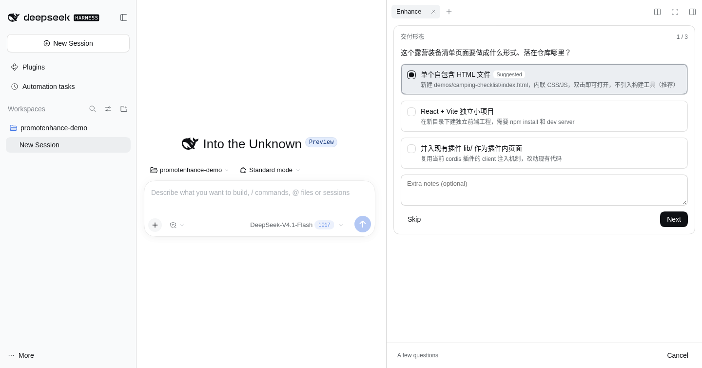

# v1.0.0 — 提示词增强，正式可用

**Release date:** 2026-11-07 · **npm package:** `dsh-prompt-enhance@1.0.0`



`dsh-prompt-enhance` turns a rough request typed in the DSH composer into a
complete, directly executable prompt. The right-side panel asks a few
high-signal questions, may inspect the target workspace (read-only), and writes
the finished prompt back into the composer — **without creating a DSH session**.

## Highlights

- **No session pollution.** Enhancement state lives in plugin memory; the chat
  transcript only receives the `/enhance` command record.
- **Structured, not stitched.** The rough prompt, the session digest and the
  answers travel as separate content blocks / tool results. No `<rough_prompt>`
  tags, no fenced-code extraction.
- **Reads before it writes.** New `read_file`, `list_dir` and `grep` tools let
  the model check the real test runner, package layout and conventions first.
- **Bounded by design.** Per-run limits for model calls, question rounds, tool
  calls, timeout and output tokens; a visible elapsed timer while it works.
- **Privacy by default.** The model sees the workspace *name*, not the host's
  absolute path; generated prompts no longer leak machine paths. Secret and
  environment files are rejected by the file tools.
- **Safe data plane.** A random per-process page token, same-origin check, JSON
  content type, 256 KiB body cap and plain-object validation.

## Added

- Config: `timeoutMs`, `maxTokens`, `maxQuestionRounds`, `maxModelCalls`,
  `maxToolCalls`, `maxRoughChars`, `fileTools` (plus the existing
  `provider` / `model` / `reasoningEffort`).
- Read-only workspace tools: `read_file`, `list_dir`, `grep`.
- `GET /prompt-enhance/health` with name, version, uptime and file-tool status.
- Elapsed-time indicator, new error strings, recommended-option sorting and
  multi-select preselection.
- 60 tests across digest, config, engine, HTTP, run store and tools.
- CI matrix for Node 20 / 22 / 24, `npm run lint`, `npm run build`,
  `npm run check`.
- Real screenshots, `docs/audit.md`, this release note, `CONTRIBUTING.md`,
  `SECURITY.md`, `LICENSE` and `CHANGELOG.md`.

## Fixed

- Cancel/timeout during model resolution, and detached errors resurrecting a
  cancelled run.
- `null` / array / primitive JSON bodies crashing the route with 500; aborted
  requests hanging the body reader.
- "Regenerate" keeping the previous draft; polling hiding network failures.
- `maxTokens: 3000` vs. a 60 000-character prompt schema.
- `/take` accepting cancelled or failed runs; expired state disappearing before
  the panel could read it.
- Insert/copy success messages lying when the request failed.
- Unbounded run table; replaced runs continuing to stream.
- Stale README and locale metadata.

## Breaking

- **Internal HTTP clients** must send the page token from
  `<meta name="dsh-prompt-enhance-token">` as `x-dsh-prompt-enhance-token` on
  `/state`, `/sessions` and every POST. The panel does this automatically.
- **Model-visible digest**: `cwd` is now the workspace basename (plus a
  `workspace` field), not an absolute path. Prompts should use relative paths.
- Version jumps from `0.2.0` to `1.0.0`; the package is now marked publishable
  and carries repository/engines/keywords metadata.

## Release asset

`dsh-prompt-enhance-1.0.0.tgz` (npm pack, includes docs and screenshots).

## Upgrade

1. Pull `v1.0.0` and restart `dsh web` (host and client bundles load at boot).
2. Refresh the browser page so it receives the new token meta tag.
3. Existing profile config keeps working; the new limits have safe defaults.
4. Verify: `curl -s http://127.0.0.1:3081/prompt-enhance/health`.

No data migration is required: the plugin never persisted enhancement state.

## Verification

```text
npm test        → 60 passed, 0 failed
npm run lint    → lint ok
npm run build   → build ok
npm audit       → 0 vulnerabilities
```

Real isolated instance: `/enhance` → 3 questions → a multi-thousand-character prompt →
Insert → composer text matches; no host path in the generated prompt.

## Links

- [README](https://github.com/EstimateFaster/dsh-plugin-promotenhance/blob/main/README.md)
- [Audit and fixes](https://github.com/EstimateFaster/dsh-plugin-promotenhance/blob/main/docs/audit.md)
- [Changelog](https://github.com/EstimateFaster/dsh-plugin-promotenhance/blob/main/CHANGELOG.md)
